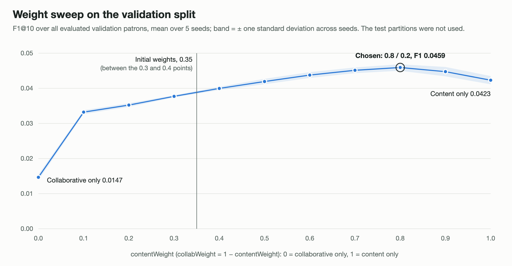
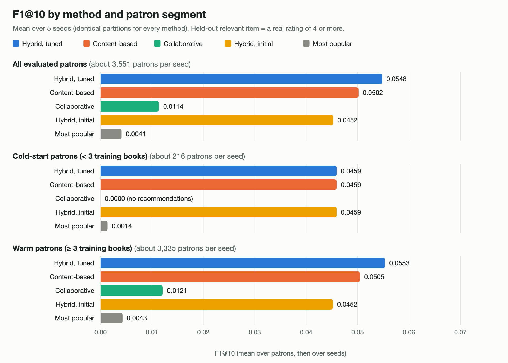

# LibRec evaluation results

Material for Chapter 4 of the seminar report. Generated by `scripts/make-results.ts` from the files in `results/` and `data/processed/`; every number below is read from those files. To regenerate, see the last section.

## Contents

1. [Dataset](#1-dataset)
2. [Evaluation protocol](#2-evaluation-protocol)
3. [Weight sweep (validation)](#3-weight-sweep-validation)
4. [Final comparison by segment](#4-final-comparison-by-segment)
5. [Coverage](#5-coverage)
6. [Component attribution](#6-component-attribution)
7. [Statistical significance](#7-statistical-significance)
8. [Verdict on H0 and H1](#8-verdict-on-h0-and-h1)
9. [Limitations](#9-limitations)
10. [Reproducing these results](#10-reproducing-these-results)

## 1. Dataset

Source: goodbooks-10k, original release (about 982,000 ratings). Cleaning followed `docs/DECISIONS.md`; all random steps use seed 42. Full detail: `data/processed/cleaning_report.md`.

| Step | Rule | Before | After |
|---|---|---|---|
| 1–2 | Keep English (eng, en-US, en-GB, en-CA; 1,084 null-language books kept); de-duplicate | 10,000 books | 9,809 books, 962,175 ratings, 52,278 users |
| 3 | 44-genre whitelist; exclude books with `erotica` in their top 3 genres | 9,809 books | 9,571 books |
| 3b | Catalogue limited to 1,000 books (at least 10 per primary genre, then most rated) | 9,571 books | 1,000 books, 99,989 ratings, 11,767 users |
| 5 | Build `content_text` = genres + author + description (963 books have a description, 37 do not) | 1,000 books | 1,000 books |
| 6 | Cap 30 ratings per user (random), then keep users with at least 3 | 11,767 users, 99,989 ratings | 4,849 users, 58,540 ratings |
| 7 | Simulate BORROW events (29,367 paired with a rating, 6,667 extra) | 58,540 ratings | 94,574 interactions |

**Final dataset**

| Quantity | Value |
|---|---|
| Books (items) | 1,000 |
| Patrons (users) | 4,849 |
| Interactions | 94,574 (58,540 ratings + 36,034 simulated borrows) |
| Distinct (patron, book) pairs | 65,207 |
| Density of the patron–book matrix | 1.345% counting all interactions (1.207% counting ratings only) |
| Sparsity | 98.66% of the matrix is empty |
| Ratings per patron | mean 12.07, median 7 (3–4: 1,579 patrons, 5–15: 1,842, 16–30: 1,428) |
| Rating values 1 / 2 / 3 / 4 / 5 | 1,551 / 4,271 / 15,067 / 20,417 / 17,234 (64.3% are 4 or 5; mean 3.81) |
| TF-IDF vocabulary | 5,163 terms |

## 2. Evaluation protocol

The same dataset, partition, preprocessing and metrics are used for every configuration (CLAUDE.md; `docs/DECISIONS.md` has the reasons).

- **Partition.** Whole (patron, book) pairs are split, so a book's borrow and rating always fall on the same side. About 20% of each patron's distinct books are held out (at least one, always keeping at least two for training). The split is seeded (mulberry32); seeds 1, 2, 3, 4, 5 give 5 different partitions. All configurations run on the identical partition and are fitted on its training part only.
- **Relevance.** A held-out book is relevant only if it is a real rating of 4 or more. Simulated borrows stay in training and never count as relevant (they were generated from each patron's tastes, so counting them would favour content-based filtering). Patrons with no relevant held-out book are left out of that seed's metrics (about 1,298 of 4,849 test patrons per seed).
- **Metrics.** Precision@10, Recall@10 and F1@10, computed per patron and averaged within a segment, then reported as the mean ± sample standard deviation over the 5 seeds. Precision divides by 10 even when fewer than 10 books are returned, so a short list is penalised. No backfilling.
- **Segments.** *Cold*: fewer than 3 distinct training books (the switching rule's own count). *Warm*: 3 or more. After the split every patron keeps at least 2 books, so the cold segment is the patrons with exactly 2.
- **Configurations.** Content-based (TF-IDF + cosine, rating-weighted mean profile, borrows weighted 3.5); collaborative (user-user Pearson on explicit ratings, at least 3 co-rated books, k = 30 positive neighbours, mean-centred prediction); the hybrid (switching rule below 3 books, otherwise min-max-normalised content score and rescaled CF prediction combined by weight) with the initial weights 0.35 / 0.65 and with the tuned weights; and *most popular* as a non-personalised sanity check, kept outside the hypothesis.
- **Weight tuning.** The weights were chosen on a validation split carved from each seed's training rows only (seed 1000 + s), by the highest mean validation F1@10 over contentWeight 0.0 to 1.0 in steps of 0.1 (ties to the lower content weight), and then evaluated once on the test partitions. The test set did not take part in the choice.

## 3. Weight sweep (validation)



| contentWeight | collabWeight | F1@10 all (mean ± sd) | F1@10 warm |
|---|---|---|---|
| 0.0 | 1.0 | 0.0147 ± 0.0008 | 0.0121 |
| 0.1 | 0.9 | 0.0332 ± 0.0006 | 0.0322 |
| 0.2 | 0.8 | 0.0352 ± 0.0005 | 0.0344 |
| 0.3 | 0.7 | 0.0377 ± 0.0003 | 0.0371 |
| 0.4 | 0.6 | 0.0400 ± 0.0005 | 0.0395 |
| 0.5 | 0.5 | 0.0419 ± 0.0008 | 0.0417 |
| 0.6 | 0.4 | 0.0438 ± 0.0008 | 0.0437 |
| 0.7 | 0.3 | 0.0451 ± 0.0008 | 0.0451 |
| 0.8 **(chosen)** | 0.2 | 0.0459 ± 0.0009 | 0.0460 |
| 0.9 | 0.1 | 0.0447 ± 0.0013 | 0.0447 |
| 1.0 | 0.0 | 0.0423 ± 0.0012 | 0.0421 |

The curve rises steadily towards content-heavy weights, peaks at 0.8 / 0.2 and falls slightly at content only. The initial weights 0.35 / 0.65 lie on the rising part of the curve, well below the peak. The cold segment is unaffected by the weights (content only), so only warm patrons move along this curve.

## 4. Final comparison by segment



**All evaluated patrons** (about 3,551 patrons per seed)

| Method | Precision@10 | Recall@10 | F1@10 |
|---|---|---|---|
| Hybrid, tuned (0.8 / 0.2) | **0.0338 ± 0.0007** | **0.1989 ± 0.0042** | **0.0548 ± 0.0011** |
| Content-based | 0.0309 ± 0.0006 | 0.1853 ± 0.0021 | 0.0502 ± 0.0008 |
| Collaborative | 0.0070 ± 0.0004 | 0.0414 ± 0.0020 | 0.0114 ± 0.0006 |
| Hybrid, initial (0.35 / 0.65) | 0.0276 ± 0.0006 | 0.1740 ± 0.0035 | 0.0452 ± 0.0010 |
| Most popular (sanity check) | 0.0026 ± 0.0003 | 0.0124 ± 0.0023 | 0.0041 ± 0.0005 |

**Cold-start patrons (< 3 training books)** (about 216 patrons per seed)

| Method | Precision@10 | Recall@10 | F1@10 |
|---|---|---|---|
| Hybrid, tuned (0.8 / 0.2) | **0.0253 ± 0.0013** | **0.2526 ± 0.0130** | **0.0459 ± 0.0024** |
| Content-based | 0.0253 ± 0.0013 | 0.2526 ± 0.0130 | 0.0459 ± 0.0024 |
| Collaborative | 0.0000 ± 0.0000 | 0.0000 ± 0.0000 | 0.0000 ± 0.0000 |
| Hybrid, initial (0.35 / 0.65) | 0.0253 ± 0.0013 | 0.2526 ± 0.0130 | 0.0459 ± 0.0024 |
| Most popular (sanity check) | 0.0008 ± 0.0007 | 0.0075 ± 0.0065 | 0.0014 ± 0.0012 |

**Warm patrons (≥ 3 training books)** (about 3,335 patrons per seed)

| Method | Precision@10 | Recall@10 | F1@10 |
|---|---|---|---|
| Hybrid, tuned (0.8 / 0.2) | **0.0344 ± 0.0008** | **0.1954 ± 0.0049** | **0.0553 ± 0.0013** |
| Content-based | 0.0312 ± 0.0006 | 0.1809 ± 0.0029 | 0.0505 ± 0.0009 |
| Collaborative | 0.0074 ± 0.0004 | 0.0440 ± 0.0021 | 0.0121 ± 0.0006 |
| Hybrid, initial (0.35 / 0.65) | 0.0277 ± 0.0008 | 0.1689 ± 0.0040 | 0.0452 ± 0.0012 |
| Most popular (sanity check) | 0.0027 ± 0.0003 | 0.0127 ± 0.0024 | 0.0043 ± 0.0006 |

On the cold segment the hybrid is the content-based recommender by construction (the switching rule never invokes collaborative filtering), so both rows are identical there; the hybrid can only change the result for warm patrons. The collaborative-only configuration cannot recommend anything to a cold-start patron, which is the weakness the switching rule is meant to cover.

## 5. Coverage

Share of evaluated patrons who received no recommendation, 1 to 9, or a full list of 10 (no backfilling).

| Method | Segment | None | 1–9 | Full list 10 |
|---|---|---|---|---|
| Hybrid, tuned | all | 0.0% | 0.0% | 100.0% |
| Hybrid, tuned | cold | 0.0% | 0.0% | 100.0% |
| Hybrid, tuned | warm | 0.0% | 0.0% | 100.0% |
| Content-based | all | 0.0% | 0.0% | 100.0% |
| Content-based | cold | 0.0% | 0.0% | 100.0% |
| Content-based | warm | 0.0% | 0.0% | 100.0% |
| Collaborative | all | 38.2% | 4.1% | 57.7% |
| Collaborative | cold | 100.0% | 0.0% | 0.0% |
| Collaborative | warm | 34.2% | 4.4% | 61.5% |
| Hybrid, initial | all | 0.0% | 0.0% | 100.0% |
| Hybrid, initial | cold | 0.0% | 0.0% | 100.0% |
| Hybrid, initial | warm | 0.0% | 0.0% | 100.0% |

Collaborative filtering alone returns a full list to only 57.7% of patrons. Over the patrons it *can* serve it scores F1@10 0.0184 ± 0.0011, which is still below content-based filtering on all patrons (0.0502 ± 0.0008); the comparison uses the all-patrons figure, as the protocol requires, and the covered-only figure is supplementary.

## 6. Component attribution

Each hybrid item is attributed to the component with the larger weighted contribution (ties to content). Cold-path items are always content.

| Hybrid | Segment | Items from content | Items from collaborative |
|---|---|---|---|
| Hybrid, tuned | all | 99.7% | 0.3% |
| Hybrid, tuned | cold | 100.0% | 0.0% |
| Hybrid, tuned | warm | 99.7% | 0.3% |
| Hybrid, initial | all | 40.6% | 59.4% |
| Hybrid, initial | cold | 100.0% | 0.0% |
| Hybrid, initial | warm | 36.7% | 63.3% |

With the tuned weights 99.70% of the recommended items are attributed to content: the tuned hybrid is almost a content-based recommender whose ordering is adjusted at the margin by collaborative predictions. With the initial weights the split is far more even, and the result is worse.

## 7. Statistical significance

Protocol (fixed before the tests were run, `docs/DECISIONS.md` 2026-10-14): two-sided tests at α = 0.05, Holm-adjusted across the three comparisons; the hypothesis is rejected against a baseline only if the hybrid is better and the adjusted Wilcoxon *p* is below 0.05 in every seed. The *t*-test on the five seed means is a robustness check. Statistics code: `lib/evaluation/stats.ts`, checked against a worked example and scipy in `tests/stats.test.ts`. Full output: `results/significance.json` and `.csv`.

**Summary (all evaluated patrons)**

| Comparison | Mean F1 difference | Wilcoxon *p* (Holm), across seeds | Rank-biserial *r* | *t*-test *p* (Holm) | Cohen's *d*<sub>z</sub> | Rule |
|---|---|---|---|---|---|---|
| Hybrid (tuned 0.8/0.2) vs content-based | +0.00460 | 6.9e-13 to 6.7e-7 | 0.39 to 0.53 | 2.9e-4 | 5.59 | first significantly better in every seed |
| Hybrid (tuned 0.8/0.2) vs collaborative | +0.04341 | 8.5e-139 to 1.2e-125 | 0.86 to 0.91 | 1.4e-7 | 47.59 | first significantly better in every seed |
| Hybrid (initial 0.35/0.65) vs content-based | −0.00493 | 1.5e-6 to 4.8e-4 | −0.24 to −0.18 | 2.9e-4 | −6.34 | first significantly worse in every seed |

Reading the effect sizes: most patrons receive exactly the same list from the two methods (identical F1), so the Wilcoxon test ranks only the patrons whose lists differ. For hybrid-tuned against content that is 6.1% to 6.9% of the evaluated patrons, and the rank-biserial correlation describes them. The mean difference over *all* patrons, +0.0046 F1 (+9.2% relative), is the practical size of the improvement.

The *t*-test degrees of freedom are 4, and the five seeds are not independent replications: they re-partition the same patrons and books. The across-seed *p*-values and the very large *d*<sub>z</sub> (the seed-to-seed spread of the difference is tiny) therefore overstate certainty and are best read as 'the sign is the same in every seed'.

Detailed per-seed results:

### All evaluated patrons

Per seed: Wilcoxon signed-rank test on the per-patron F1@10 differences (first − second), paired by patron. *n* is the number of patrons whose two lists scored differently (the only ones that can be ranked); *zeros* is how many scored identically. Holm-adjusted *p* is corrected across the three comparisons.

**Hybrid (tuned 0.8/0.2) vs content-based**

| Seed | n | zeros | Mean F1 difference | *p* (Wilcoxon) | *p* (Holm) | Rank-biserial *r* |
|---|---|---|---|---|---|---|
| 1 | 222 | 3,315 | +0.00361 | 3.3e-7 | 6.7e-7 | 0.394 |
| 2 | 219 | 3,363 | +0.00384 | 6.7e-9 | 1.3e-8 | 0.450 |
| 3 | 248 | 3,323 | +0.00495 | 5.9e-13 | 1.2e-12 | 0.526 |
| 4 | 245 | 3,304 | +0.00542 | 3.4e-13 | 6.9e-13 | 0.534 |
| 5 | 241 | 3,274 | +0.00519 | 6.2e-12 | 1.2e-11 | 0.509 |

Across the 5 seed means (paired *t*-test): mean difference +0.00460, *t*(4) = 12.50, *p* = 2.4e-4 (Holm 2.9e-4), Cohen's *d*<sub>z</sub> = 5.59. Decision rule: first significantly better in every seed.

**Hybrid (tuned 0.8/0.2) vs collaborative**

| Seed | n | zeros | Mean F1 difference | *p* (Wilcoxon) | *p* (Holm) | Rank-biserial *r* |
|---|---|---|---|---|---|---|
| 1 | 988 | 2,549 | +0.04205 | 4.0e-126 | 1.2e-125 | 0.869 |
| 2 | 1,015 | 2,567 | +0.04291 | 3.4e-127 | 1.0e-126 | 0.862 |
| 3 | 1,008 | 2,563 | +0.04411 | 2.8e-139 | 8.5e-139 | 0.905 |
| 4 | 1,014 | 2,535 | +0.04416 | 9.3e-131 | 2.8e-130 | 0.874 |
| 5 | 971 | 2,544 | +0.04384 | 2.9e-132 | 8.8e-132 | 0.898 |

Across the 5 seed means (paired *t*-test): mean difference +0.04341, *t*(4) = 106.41, *p* = 4.7e-8 (Holm 1.4e-7), Cohen's *d*<sub>z</sub> = 47.59. Decision rule: first significantly better in every seed.

**Hybrid (initial 0.35/0.65) vs content-based**

| Seed | n | zeros | Mean F1 difference | *p* (Wilcoxon) | *p* (Holm) | Rank-biserial *r* |
|---|---|---|---|---|---|---|
| 1 | 481 | 3,056 | −0.00513 | 1.9e-5 | 1.9e-5 | −0.224 |
| 2 | 513 | 3,069 | −0.00609 | 1.5e-6 | 1.5e-6 | −0.245 |
| 3 | 495 | 3,076 | −0.00457 | 3.8e-4 | 3.8e-4 | −0.184 |
| 4 | 468 | 3,081 | −0.00398 | 4.8e-4 | 4.8e-4 | −0.186 |
| 5 | 486 | 3,029 | −0.00489 | 6.5e-5 | 6.5e-5 | −0.208 |

Across the 5 seed means (paired *t*-test): mean difference −0.00493, *t*(4) = −14.17, *p* = 1.4e-4 (Holm 2.9e-4), Cohen's *d*<sub>z</sub> = −6.34. Decision rule: first significantly worse in every seed.

### Warm patrons only

Per seed: Wilcoxon signed-rank test on the per-patron F1@10 differences (first − second), paired by patron. *n* is the number of patrons whose two lists scored differently (the only ones that can be ranked); *zeros* is how many scored identically. Holm-adjusted *p* is corrected across the three comparisons.

**Hybrid (tuned 0.8/0.2) vs content-based**

| Seed | n | zeros | Mean F1 difference | *p* (Wilcoxon) | *p* (Holm) | Rank-biserial *r* |
|---|---|---|---|---|---|---|
| 1 | 222 | 3,096 | +0.00384 | 3.3e-7 | 6.7e-7 | 0.394 |
| 2 | 219 | 3,153 | +0.00408 | 6.7e-9 | 1.3e-8 | 0.450 |
| 3 | 248 | 3,101 | +0.00528 | 5.9e-13 | 1.2e-12 | 0.526 |
| 4 | 245 | 3,095 | +0.00576 | 3.4e-13 | 6.9e-13 | 0.534 |
| 5 | 241 | 3,054 | +0.00554 | 6.2e-12 | 1.2e-11 | 0.509 |

Across the 5 seed means (paired *t*-test): mean difference +0.00490, *t*(4) = 12.49, *p* = 2.4e-4 (Holm 2.8e-4), Cohen's *d*<sub>z</sub> = 5.58. Decision rule: first significantly better in every seed.

**Hybrid (tuned 0.8/0.2) vs collaborative**

| Seed | n | zeros | Mean F1 difference | *p* (Wilcoxon) | *p* (Holm) | Rank-biserial *r* |
|---|---|---|---|---|---|---|
| 1 | 929 | 2,389 | +0.04159 | 1.2e-114 | 3.6e-114 | 0.855 |
| 2 | 963 | 2,409 | +0.04278 | 5.7e-117 | 1.7e-116 | 0.850 |
| 3 | 952 | 2,397 | +0.04399 | 1.8e-128 | 5.5e-128 | 0.896 |
| 4 | 965 | 2,375 | +0.04425 | 3.2e-121 | 9.5e-121 | 0.864 |
| 5 | 914 | 2,381 | +0.04362 | 3.4e-121 | 1.0e-120 | 0.887 |

Across the 5 seed means (paired *t*-test): mean difference +0.04325, *t*(4) = 89.57, *p* = 9.3e-8 (Holm 2.8e-7), Cohen's *d*<sub>z</sub> = 40.06. Decision rule: first significantly better in every seed.

**Hybrid (initial 0.35/0.65) vs content-based**

| Seed | n | zeros | Mean F1 difference | *p* (Wilcoxon) | *p* (Holm) | Rank-biserial *r* |
|---|---|---|---|---|---|---|
| 1 | 481 | 2,837 | −0.00547 | 1.9e-5 | 1.9e-5 | −0.224 |
| 2 | 513 | 2,859 | −0.00647 | 1.5e-6 | 1.5e-6 | −0.245 |
| 3 | 495 | 2,854 | −0.00487 | 3.8e-4 | 3.8e-4 | −0.184 |
| 4 | 468 | 2,872 | −0.00423 | 4.8e-4 | 4.8e-4 | −0.186 |
| 5 | 486 | 2,809 | −0.00522 | 6.5e-5 | 6.5e-5 | −0.208 |

Across the 5 seed means (paired *t*-test): mean difference −0.00525, *t*(4) = −14.23, *p* = 1.4e-4 (Holm 2.8e-4), Cohen's *d*<sub>z</sub> = −6.36. Decision rule: first significantly worse in every seed.


## 8. Verdict on H0 and H1

- **H0:** the hybrid gives no significant improvement over the baselines. **H1:** it gives a significant improvement. The test quantity is (hybrid metric) − (better baseline metric).
- The better baseline is **content-based** filtering (F1@10 0.0502 against 0.0114).
- **With the tuned weights (0.8 / 0.2), H0 is rejected in favour of H1 against both baselines.** The hybrid beats content-based filtering in all 5 seeds (mean F1@10 0.0548 against 0.0502, a gain of 0.0046 or 9.2%), and beats collaborative filtering by a wide margin. The improvement over the better baseline is statistically significant but small in absolute terms.
- **With the pre-registered initial weights (0.35 / 0.65), H1 is not supported:** the hybrid is significantly *worse* than content-based filtering in every seed (mean F1@10 0.0452 against 0.0502). Weighting collaborative filtering at 0.65 hurts on this dataset.
- **Interpretation.** The hybrid helps only when it leans heavily on content-based filtering and uses collaborative predictions as a small correction. The switching rule is doing its job (cold-start patrons get content-based results, whereas collaborative filtering alone serves none of them), but the evidence for the *weighted combination* is modest: a significant gain of about 9% over the best single technique, on a dataset where simulated borrows favour content-based filtering, with weights tuned on patrons that also appear in the test set (section 9).

## 9. Limitations

1. **Simulated borrows and synthetic timestamps.** 38% of the interactions are simulated borrows, generated from each patron's own top genres, so they are consistent with taste by construction and favour content-based methods. They never count as relevant, but they enter every patron's training history and the content profile. All timestamps (borrows and ratings) were assigned within one academic session (2024-09-02 to 2025-06-27); nothing temporal can be concluded, and the admin statistics label them synthetic.
2. **Validation and test share patrons.** The validation split is carved from each seed's training rows, and the test rows belong to the same patrons. No held-out test pair was used to choose the weights, but the choice is not fully independent of the test data, so the tuned-weights result is somewhat optimistic. A split by patron would remove this.
3. **Positive rating skew.** 64.3% of ratings are 4 or 5 (mean 3.81), so "relevant" is a common outcome and rating-weighted profiles carry little negative signal; low ratings (1–2) still pull a content profile towards the book, as in the plain weighted mean the report specifies.
4. **No collaborative-filtering support threshold.** A book rated by a single neighbour can receive an extreme prediction. Adding a minimum-support rule after seeing results would have been tuning on test data, so it is left as future work. Pearson also requires at least 3 co-rated books, which many patrons cannot satisfy on this sparse data: collaborative filtering alone serves 61% of warm patrons with a full list.
5. **Popularity's flat curve.** The most-popular sanity baseline scores only F1@10 0.0041. The catalogue was built to be broad (at least 10 books per genre, then most rated) and users were capped at 30 ratings, so interest is spread out: the 10 most-read books account for 1.7% of patron–book pairs and the top 100 for 15.4%, where a heavily skewed catalogue would show far more (an even spread would give 1% and 10%). This is the likely reason popularity carries little signal here, though this evaluation does not test that explanation. On a more skewed library it would be a harder baseline to beat.
6. **The initial 0.35 / 0.65 weights underperform content-based filtering.** They were a starting guess (the report's), not a principled choice, and on this dataset they are significantly worse than the best single technique (F1@10 0.0452 against 0.0502). The approved weights come from the validation sweep, not from the initial values, and the report should present both.
7. **One dataset, one catalogue size.** 1,000 books and 4,849 patrons from a public ratings dataset, not a real library's circulation records. The p-values describe this dataset and protocol.
8. **Item cold-start.** A book with no ratings gets no collaborative contribution (it can only be ranked by content), as decided in `docs/DECISIONS.md`; the evaluation does not isolate this case.

## 10. Reproducing these results

```bash
npm install
npm run db:up                                    # only needed for the app and the tests, not for the evaluation
npx tsx scripts/evaluate.ts --configs content,collab,hybrid,hybrid-tuned,popular --seeds 1,2,3,4,5 --n 10 --out results/eval-final
npx tsx scripts/significance.ts                  # per-patron paired tests -> results/significance.json / .csv
npx tsx scripts/make-results.ts                  # this file and results/charts/*.png
```

The evaluation reads `data/processed/*.csv` directly (no database) and is deterministic for a given seed. Generated: 2026-10-14.
